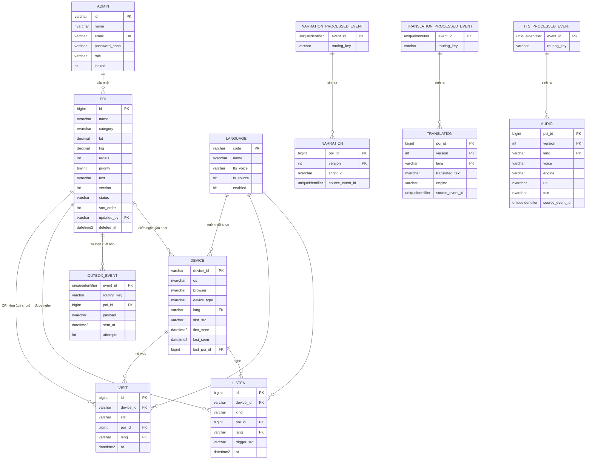

# Cơ sở dữ liệu – Thuyết minh tự động đa ngôn ngữ

File chạy: [`ThuyetMinhTuDong-sqlserver.sql`](ThuyetMinhTuDong-sqlserver.sql) (SQL Server 2019+ / Express).
Cách chạy: mở SSMS → File → Open → chọn file → Execute (F5). Chạy lại nhiều lần được (tự xoá rồi tạo lại).

> Hiện các service vẫn lưu dữ liệu **trong bộ nhớ** (bản PoC). File này là thiết kế CSDL hoàn chỉnh để nối vào
> bằng Spring Data JPA ở bước sau; mỗi service chỉ đọc/ghi schema của mình.

## 1. Nguyên tắc: mỗi service sở hữu dữ liệu của mình (database-per-service)

| Schema | Service sở hữu | Bảng | Ghi bởi sự kiện / API |
|---|---|---|---|
| `content` | content-service | `ADMIN`, `LANGUAGE`, `POI`, `DEVICE`, `VISIT`, `LISTEN`, `OUTBOX_EVENT` | REST `/api/pois`, `/api/devices`; phát `content.published` |
| `narration` | narration-service | `NARRATION`, `PROCESSED_EVENT` | nhận `content.published`, phát `narration.created` |
| `translation` | translation-service | `TRANSLATION`, `PROCESSED_EVENT` | nhận `narration.created`, phát `translation.completed` |
| `tts` | tts-service | `AUDIO`, `PROCESSED_EVENT` | nhận `translation.completed`, phát `audio.ready` |
| — | notification-service | (không lưu) | chuyển tiếp sự kiện qua WebSocket |

- 4 schema đặt chung 1 database cho dễ chạy khi làm đồ án; khi triển khai thật mỗi schema tách thành 1 database
  riêng mà không phải sửa bảng nào.
- **Không có khoá ngoại giữa hai service.** `poi_id`, `version`, `lang` ở narration/translation/tts chỉ là giá trị
  lấy từ sự kiện RabbitMQ (xem `EVENTS.md`). Một service có thể đổi CSDL, chết hoặc khởi động lại mà không làm
  hỏng ràng buộc của service khác. Câu kiểm tra cuối file xác nhận điều này (0 khoá ngoại liên schema).
- **`PROCESSED_EVENT`** (narration, translation, tts): lưu `eventId` đã xử lý để chống xử lý trùng khi RabbitMQ
  giao lại một tin (thay cho `processedEventIds` đang nằm trong bộ nhớ).
- **`OUTBOX_EVENT`** (content): transactional outbox – sự kiện `content.published` được ghi cùng giao dịch với
  việc xuất bản POI, rồi một tiến trình gửi lên RabbitMQ và điền `sent_at`. Tránh trường hợp lưu POI xong nhưng
  gửi sự kiện thất bại (hoặc ngược lại).

## 2. Sơ đồ ERD


(`*_PROCESSED_EVENT` là bảng `PROCESSED_EVENT` trong schema `narration`, `translation`, `tts`.)

**Đường nối trong sơ đồ:** khoá ngoại chỉ có *bên trong* một service. Ở content-service, 7 bảng nối với nhau
(10 khoá ngoại). Ở mỗi service còn lại, dữ liệu (`NARRATION`, `TRANSLATION`, `AUDIO`) nối với bảng
`PROCESSED_EVENT` của chính nó qua `source_event_id`: mỗi dòng được sinh ra từ đúng một sự kiện đã nhận.
Vì vậy diagram trong SSMS có 4 cụm bảng tách rời – đó là 4 service, cố ý không nối nhau.

Giữa các service, `NARRATION`, `TRANSLATION`, `AUDIO` nối với nhau và với `POI` **qua sự kiện**, không qua khoá ngoại:

```
content.POI --content.published--> narration.NARRATION --narration.created--> translation.TRANSLATION
            --translation.completed--> tts.AUDIO --audio.ready--> notification-service --> web
```
Mỗi bảng phía sau giữ `source_event_id` = `eventId` của sự kiện đã tạo ra nó, nên truy vết được cả chuỗi.

## 3. Các quyết định thiết kế

| Vấn đề | Cách xử lý |
|---|---|
| Phiên bản nội dung | `POI.version` tăng mỗi lần sửa; `NARRATION`/`TRANSLATION`/`AUDIO` có khoá `(poi_id, version, ...)` nên giữ lịch sử từng phiên bản. |
| Xoá POI | **Xoá mềm** bằng `deleted_at`: `DELETE /api/pois/{id}` đặt thời điểm xoá, POI biến mất khỏi web nhưng thống kê lượt nghe cũ vẫn còn (không vướng khoá ngoại). |
| Du khách ẩn danh | Không có bảng tài khoản du khách. `DEVICE.device_id` là mã ngẫu nhiên trình duyệt tự tạo; không lưu tên, email, IP. |
| Lượt nghe tổng quan | `LISTEN.kind = 'overview'` và `poi_id` NULL; ràng buộc `CK_LISTEN_kind` bắt buộc hai cột khớp nhau. |
| Đa ngôn ngữ | Bảng `LANGUAGE` (chỉ một ngôn ngữ gốc nhờ unique index có điều kiện). Cột chữ dùng `NVARCHAR`, database dùng collation `Vietnamese_CI_AS`. |
| Toạ độ | `DECIMAL(9,6)` (độ chính xác ~0,1 m), kiểm tra miền giá trị vĩ độ / kinh độ. |
| Giờ | Lưu UTC (`SYSUTCDATETIME()`); view thống kê đổi sang giờ Việt Nam (+7). |
| TTS | Bản PoC: `engine = 'client-speech'` (trình duyệt đọc). Khi dùng TTS thật (`google-tts`, `azure-tts`) ràng buộc `CK_AUDIO_file` bắt buộc có `url` file mp3. |

## 4. Index và view thống kê

| Đối tượng | Phục vụ |
|---|---|
| `IX_POI_published` (có điều kiện) | `GET /api/pois` cho web du khách: điểm đã xuất bản, chưa xoá, theo thứ tự tham quan |
| `IX_DEVICE_last_seen` | đếm thiết bị "đang tham gia" (tín hiệu trong 2 phút) |
| `IX_VISIT_at`, `IX_VISIT_device` | thống kê lượt mở / quét QR theo ngày, theo thiết bị |
| `IX_LISTEN_poi_at`, `IX_LISTEN_at` | lượt nghe theo điểm, theo ngày |
| `IX_OUTBOX_pending` (có điều kiện) | tìm sự kiện chưa gửi |
| `V_POI_STATS` | lượt nghe, số thiết bị, lượt nghe theo vi/en/zh của từng điểm (trang Admin) |
| `V_DAILY_ACTIVITY` | lượt mở, thiết bị, lượt quét QR theo ngày (giờ VN) |
| `V_ACTIVE_DEVICE` | thiết bị đang tham gia và điểm đang nghe |

## 5. Dữ liệu mẫu và kiểm tra

- 6 điểm thuyết minh Dinh Độc Lập (đã xuất bản, v1), kèm bài thuyết minh, 3 bản dịch, 3 giọng đọc cho mỗi điểm –
  nội dung khớp đúng với những gì narration-service soạn (câu chào + nội dung + câu kết).
- 4 thiết bị, 5 lượt mở, 9 lượt nghe mẫu để view thống kê có số liệu.
- Cuối file có các câu kiểm tra: số bảng theo schema (13), **0 khoá ngoại liên schema**, mỗi điểm đủ 1 bài
  thuyết minh / 3 bản dịch / 3 giọng đọc, số khoá ngoại trong từng service, và kết quả các view.

## 6. Lược đồ quan hệ

Ký hiệu: <ins>gạch chân</ins> = khoá chính, `#` = khoá ngoại (trỏ tới bảng trong ngoặc), `UQ` = duy nhất.
Mọi khoá ngoại đều nằm **trong cùng một schema** (cùng một service).

### Schema `content` (content-service)
1. **ADMIN**(<ins>id</ins>, name, email UQ, password_hash, role, locked, created_at)
2. **LANGUAGE**(<ins>code</ins>, name, tts_voice, is_source, enabled)
3. **POI**(<ins>id</ins>, name, category, address, lat, lng, radius, priority, image, text, version, status, sort_order, created_at, updated_at, #updated_by → ADMIN, deleted_at)
4. **DEVICE**(<ins>device_id</ins>, os, browser, device_type, #lang → LANGUAGE, first_src, first_seen, last_seen, #last_poi_id → POI)
5. **VISIT**(<ins>id</ins>, #device_id → DEVICE, src, #poi_id → POI, #lang → LANGUAGE, at)
6. **LISTEN**(<ins>id</ins>, #device_id → DEVICE, kind, #poi_id → POI, #lang → LANGUAGE, trigger_src, at)
7. **OUTBOX_EVENT**(<ins>event_id</ins>, routing_key, #poi_id → POI, payload, created_at, sent_at, attempts)

### Schema `narration` (narration-service)
8. **PROCESSED_EVENT**(<ins>event_id</ins>, routing_key, received_at)
9. **NARRATION**(<ins>poi_id, version</ins>, script_vi, #source_event_id → PROCESSED_EVENT, created_at)

### Schema `translation` (translation-service)
10. **PROCESSED_EVENT**(<ins>event_id</ins>, routing_key, received_at)
11. **TRANSLATION**(<ins>poi_id, version, lang</ins>, source_lang, translated_text, engine, #source_event_id → PROCESSED_EVENT, translated_at)

### Schema `tts` (tts-service)
12. **PROCESSED_EVENT**(<ins>event_id</ins>, routing_key, received_at)
13. **AUDIO**(<ins>poi_id, version, lang</ins>, voice, engine, url, text, duration_sec, #source_event_id → PROCESSED_EVENT, created_at)

> `poi_id`, `version`, `lang` ở NARRATION / TRANSLATION / AUDIO **không** là khoá ngoại: chúng là giá trị lấy từ sự kiện
> của service trước (xem mục 1), vì các service không dùng chung dữ liệu.

### Quan hệ giữa các bảng (bản số)

| Quan hệ | Bản số | Ý nghĩa |
|---|---|---|
| ADMIN – POI | 1 – n | một admin cập nhật nhiều điểm |
| DEVICE – VISIT | 1 – n | một thiết bị mở web nhiều lần |
| DEVICE – LISTEN | 1 – n | một thiết bị nghe nhiều lần |
| POI – LISTEN | 1 – n | một điểm được nghe nhiều lần (lượt nghe tổng quan không gắn điểm) |
| POI – VISIT | 1 – n (tuỳ chọn) | QR riêng của điểm; QR chung thì `poi_id` rỗng |
| POI – DEVICE | 1 – n (tuỳ chọn) | điểm nghe gần nhất của thiết bị |
| POI – OUTBOX_EVENT | 1 – n | mỗi lần xuất bản sinh một sự kiện |
| LANGUAGE – DEVICE / VISIT / LISTEN | 1 – n | ngôn ngữ đang chọn |
| PROCESSED_EVENT – NARRATION | 1 – 1 | một `content.published` sinh một bài thuyết minh |
| PROCESSED_EVENT – TRANSLATION | 1 – n | một `narration.created` sinh bản dịch cho từng ngôn ngữ |
| PROCESSED_EVENT – AUDIO | 1 – n | một `translation.completed` sinh giọng đọc cho từng ngôn ngữ |

### Phụ thuộc hàm và dạng chuẩn

| Bảng | Phụ thuộc hàm chính | Dạng chuẩn |
|---|---|---|
| ADMIN | id → mọi thuộc tính; email → id | BCNF (id, email đều là khoá) |
| LANGUAGE, POI, VISIT, LISTEN, OUTBOX_EVENT, PROCESSED_EVENT | khoá chính → mọi thuộc tính | BCNF |
| DEVICE | device_id → mọi thuộc tính | BCNF (xem ghi chú `last_poi_id`) |
| NARRATION | (poi_id, version) → script_vi, source_event_id; source_event_id → (poi_id, version) | BCNF (source_event_id cũng là khoá ứng viên) |
| TRANSLATION | (poi_id, version, lang) → các thuộc tính còn lại; source_event_id → (poi_id, version) | **3NF** (vế phải là thuộc tính khoá) |
| AUDIO | (poi_id, version, lang) → các thuộc tính còn lại; source_event_id → (poi_id, version) | **3NF** (như trên) |

Ghi chú (các chỗ cố ý chấp nhận, có lý do):
- **TRANSLATION, AUDIO dừng ở 3NF:** một sự kiện sinh nhiều dòng (mỗi ngôn ngữ một dòng) nên `source_event_id`
  xác định `(poi_id, version)` mà không là khoá. Tách ra bảng riêng chỉ để đạt BCNF sẽ thêm một phép nối mà không
  giảm dư thừa đáng kể (mỗi sự kiện chỉ có 3 dòng).
- **AUDIO.voice** lưu theo từng bản ghi (không lấy theo `lang`) để giữ đúng giọng đã dùng lúc tạo: đổi cấu hình
  giọng sau này không làm sai lịch sử. Vì vậy `lang → voice` không phải phụ thuộc hàm bền vững của bảng.
- **DEVICE.last_poi_id** suy ra được từ LISTEN mới nhất; giữ lại (phi chuẩn hoá có chủ đích) để đếm "đang nghe
  điểm nào" mỗi 5 giây ở trang Admin mà không phải quét bảng LISTEN.
- **OUTBOX_EVENT.payload** chụp lại nội dung POI lúc xuất bản (snapshot), không phải dữ liệu trùng: POI sửa sau đó
  không được làm thay đổi sự kiện đã gửi.
- **LISTEN.kind** đi cùng `poi_id` (overview ⇔ rỗng); ràng buộc `CK_LISTEN_kind` bảo đảm hai cột luôn khớp.
